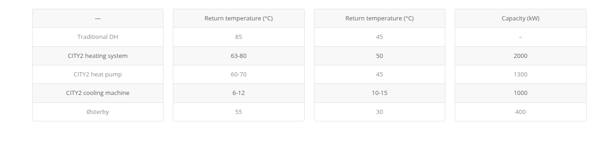

ground water source heat pump (1.5 MW):

Extracting energy from groundwater to heat homes
The groundwater is pumped up and passed through an electric heat pump which recovers the heat from the water. Then, the cooled water is pumped out into the Mølleåen river.

During the process, the temperature of the water falls from 9-12 degrees Celsius to around 4 degrees Celsius.

Høje Taastrup Fjernvarme retrieves groundwater from two wells in the eastern parts of Høje-Taastrup Municipality. The wells were previously used to extract drinking water. However, due to falling water consumption and too much nickel in the water, the wells were discontinued in the 1990s.

The groundwater is retrieved from a depth of around 10 meters. It is 9-12 degrees Celsius when pumped up and sent to the 1.5-megawatt electric heat pump.

The heat pump recovers the energy from the water and produces heat that is distributed through the district heating system. The facility provides heating to around 150 homes.

The temperature of the water drops to around 4 degrees Celsius after it has passed through the heat pump. The cooled water is channelled via an approximately 200-meter-long concrete-lined channel into Mølleåen.

Once the facility is running on full capacity, it will be able to pump around 1.4 million cubic metres of groundwater a year, with the heat pump able to produce around 13,000 MWh a year. This corresponds to 4% of the municipality's district heating consumption. Høje Taastrup Fjernvarme meets 70% of the municipality's heating consumption.

The facility is operated for approximately nine months of a year. During the remaining three months, the district-heating company uses waste heat from a biogas plant, as this is the most financially viable solution during the three remaining months.

The heat pump can be easily turned off and on depending on the price of Høje Taastrup Fjernvarme's other energy supply.

It is expected that more water wells will be discontinued in the municipality in the years to come. Furthermore, the municipality expects that the water table will rise by another 50 centimetres.

The groundwater heat pump system can be scaled up easily. And the municipality and the district-heating company anticipate the deployment of more heat pumps in the coming years.

The head of engineering at Høje Taastrup Fjernvarme, Uffe Schleiss, got the idea for the project. He believes that the system also has potential elsewhere.