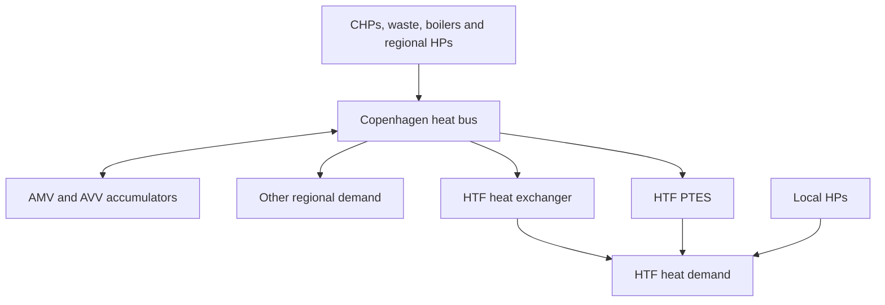

# PyPSA formulation and coupling assumptions

The network uses hourly snapshots, MW powers, MWh inventories and DKK costs.
Capacities are fixed. Production and storage are optimised with perfect foresight
for the chosen horizon. This is an operational benchmark, not an investment model
or a reconstruction of Varmelast's forecast/announcement process.

## Native components and heat boundaries

Copenhagen and HTF have separate heat buses. Fuel generators supply CHP/boiler fuel
buses; conversion links deliver heat and electricity. One signed electricity-market
generator buys/sells at externally supplied DK2 prices. HPs consume electricity
through COP-dependent links. Stores have separate charge/discharge links.

Let R be CTR+VEKS demand, L local HTF demand, H direct supply, C delivered charging
heat and D delivered discharge. The local balance is H+D+sum(Q_HP)=L. The provisional
gross-demand boundary uses other regional demand R-L. Negative residuals are errors.
The alternate residual_excluding_htf setting uses R directly as the other demand.
A net-withdrawal interpretation is rejected without historical local withdrawal data.

With delivery factor r=1-network_loss_fraction, upstream production plus regional
storage discharge minus charging equals (R-L+H+C)/r. Native HX and PTES charger links
apply r; the residual regional load is divided by r. Regional accumulators attach to
the production bus. Thus CSV H/C are delivered MW, while their upstream link p0
values are H/r and C/r. The 2% default is a scenario, not calibrated network losses.
CTR and VEKS inputs are retained individually but share one uncongested heat area.

## CHP representation and bypass correction

Backpressure units AMV1, AMV4 and KKV8 have a multi-output link with P=eta_el*F_bp
and Q_bp=P/Cm. A heat-only bypass link uses Q_b=eta_bypass*F_b. The common fuel
supply imposes F_bp+F_b <= available fuel capacity; total heat also has a capacity
bound. The bypass_mw input denotes EXTRA heat capacity in heat-only operation.
The full heat-only limit is therefore heat_mw+bypass_mw. It is not bypass_mw alone.
The former direct implementation imposed the latter limit and underrepresented
this operating mode. For AMV4, the full un-derated heat-only design point is
550 MW heat from 487 MW fuel. A dedicated test verifies this point and shared fuel.

For extraction units AVV1/AVV2, two fuel-allocation links implement
F=(P+Cv*Q)/eta_cond, with P>=Cm*Q and heat, electricity and fuel capacity bounds.
The heat link's eta_cond/Cv coefficient is an opportunity-cost coefficient; it
must not be interpreted in isolation as a standalone boiler efficiency. Positive
fuel prices put efficient dispatch on this frontier, matching the former inequality
region at an optimum. Negative CHP fuel prices are rejected because they need an
explicit formulation for inefficient fuel disposal. Alternative AVV2 equipment modes
are not added as independent capacity. Availability derating remains a scenario.

CHP starts, minimum loads and ramps remain omitted. Electricity prices are exogenous;
CHP exports do not clear or change the electricity market.

## Waste, boilers and regional storage

The aggregate waste fleet has a 519.5 MW heat-capacity ceiling and hourly output
bounded by observed aggregate waste output, treated as availability. Its electricity
output is 0.25 times heat. This does not enforce must-take waste contracts or actual
plant-level throughput. Unused availability is reported. Peak boiler fuel options
share an aggregate heat-capacity ceiling; individual dual-fuel boiler sites are not
resolved. Regional HP capacity/COP and all financial adders remain scenario inputs.

AMV and AVV stores have fixed power/energy limits, standing losses and equal initial/
final inventories. Their continuous charge/discharge flows share converter capacity;
simultaneous operation remains an explicit relaxation and is reported.

## PTES and local HP operation

The common inventory equation is E_t=(1-lambda)E_(t-1)+eta_c*C_t-D_t/eta_d.
Initial and terminal energies are fixed. In PyPSA 1.0.4, native Store initialisation
inserts e_initial without first-hour decay. An explicit first-hour load on each
inventory bus accounts for lambda*E_initial; later losses use native standing_loss.
This keeps e_initial equal to the physical pre-loss inventory and preserves the
same first-hour equation as the previous direct formulation.

Default PTES settings are 3300 MWh, symmetric 23 MW power, 10/5 MW minimum charge/
discharge, 12 MW/h ramps from initially idle operation, no simultaneous operation
and two following hours without reversal. Power is delivered heat. A 30 MW scenario
and asymmetric actual charge/discharge ratings require validation. No cyclic mode
or ramp connection is imposed across the year boundary. Final flow is free but
final inventory is fixed. HX direct flow has a 0.5 MW minimum; H+C<=100 MW is an
assumed shared connection. The 12-hour full-charge/full-discharge restriction is
not implemented. Loss 0.000275/h and zero pumping are provisional assumptions.

Native committable HP links use hourly COP, 25% minimum load, two-hour minimum up/
down times, startup costs and an initially off state. Electrical link p_max_pu is
adjusted with COP so thermal output never exceeds its rating. Custom constraints
make transitions exact and forbid starts/stops that cannot complete their minimum
duration by the horizon end. The must_run option instead fixes full thermal output
and assumes the units were already running, with no startup event in the horizon.
A real must-run/availability profile is not inferred from that full-output scenario.

## Objectives and one-pass coupling

The coordinated objective sums fuel, variable O&M, electricity purchases and local
HP starts, less electricity sales. Scenario electricity adders are included.
This is net operating expenditure, not a calibrated societal-welfare measure.
Heat payments and credits are internal transfers and do not enter this objective.
Negative objectives can include condensing-power profits, not negative heat tariffs.

The discharge-service HTF objective sums tau*H+(tau-delta)*D, local HP electricity,
discharge pumping and HP startup costs. Charging heat and charge pumping belong to
the upstream boundary. The monthly reference tariff tau and candidate credit delta
require contractual/methodological validation. The optional legacy_owned_store
boundary instead bills tau*(H+C)-delta*D and allocates both pumping flows locally;
it is not used by the coupled comparison.

The default local response imposes 0<=C<=C_announced with the same inventory endpoints.
Here charging is a feasibility variable within an assumed upstream availability
ceiling, not a claim that HTF controls central charging. Lower discharge can be
accompanied by lower charging, avoiding nearly fixed throughput. A separate fixed
policy imposes C=C_announced and retains the old restricted experiment.

Corrective system dispatch fixes the local H, D and both local HP heat outputs. It
chooses production, regional storage and compatible C<=C_announced with all physical
constraints and common inventory endpoints. Its PTES charging/inventory trajectory
is authoritative. The local trajectory was a feasibility witness; it need not be
the final upstream charging schedule. This assumes upstream charging can be curtailed
within its announced slots. Costs and curtailed charging are reported, rather than
assuming the adjustment is free. No charging outside those slots is introduced.

compare runs central dispatch once, then reference and candidate local/corrective
pairs. It reports corrective system operating-cost differences, HTF bills and supplier
local heat revenue separately, with absolute solver gap bounds. Reference and
candidate share the same inputs, schedule, constraints and endpoints. Revenue is
not supplier profit. With zero pumping and equal tariffs, local operation can be
indifferent; a selected optimum is not observed behaviour. The current implementation
is a rational one-pass benchmark, not a behavioural equilibrium or tariff derivation.
Deviation charges, electricity imbalance settlement, terminal-value alternatives,
rolling forecasts and repeated feedback remain research tasks.
Corrective electricity purchases and sales use the same exogenous DK2 prices as
central scheduling; the cost difference is not actual balancing-market settlement.

## Prices, export and reproducibility

--prices rebuilds a continuous PyPSA/Linopy model with every accepted commitment
and PTES mode fixed. Bus duals are conditional marginal operating values; they
exclude the cost of changing commitment. A demand perturbation at the delivered
boundary has derivative upstream_bus_dual/r, verified by a finite-difference test.
Raw MILP duals are not reported. Conditional LP bus prices are stored in the exported
network and upstream values in the CSV. LP relaxations are labelled explicitly.

PyPSA snapshots are timezone-naive UTC; CSV timestamps remain timezone-aware UTC.
The network metadata records this convention, scenario, runtime and input hashes.
Custom PTES statuses are recorded on the links' status table and CSV. Native network
exports preserve component data and results, not custom constraints. Re-solving
requires this builder and its constraint callback, or a separately saved Linopy model.

Implementation references: [PyPSA custom constraints](https://docs.pypsa.org/v1.0.4/user-guide/optimization/custom-constraints/)
and [storage](https://docs.pypsa.org/v1.0.4/user-guide/optimization/storage/).
